# AWS E-Commerce Data Lake & Analytics Platform

[](https://www.python.org/)
[](https://aws.amazon.com/)
[-green)](#architecture-overview)
[](https://opensource.org/licenses/MIT)

An end-to-end, production-grade batch data engineering platform built on the **Brazilian E-Commerce Public Dataset by Olist**. The platform ingests multi-source e-commerce records, enforces data quality checks, quarantines anomalous data, transforms datasets through Medallion architecture layers using PySpark, catalogs them with the AWS Glue Data Catalog, and enables analytical queries using Amazon Athena.

---

## Architecture Overview

```text
               OLIST E-COMMERCE SOURCE DATA
          (Orders, Items, Payments, Products, etc.)
                            │
                            ▼
               1. INGESTION ENGINE (Python)
         Checksum verification, file validation, manifests
                            │
                            ▼
               2. BRONZE LAYER (Amazon S3 / Local)
          Immutable raw storage, date-partitioned landing
                            │
                            ▼
           3. DATA QUALITY & CLEANING (PySpark)
       Normalization, timestamp parsing, schema enforcement
                            │
               ┌────────────┴────────────┐
               │                         │
               ▼                         ▼
      4. SILVER LAYER (Parquet)    QUARANTINE ZONE
      Cleaned, typed, deduplicated  Invalid records with
                                    error reason codes
               │
               ▼
      5. GOLD LAYER (Star Schema & Data Marts)
      Fact & Dimension tables (fact_order_items,
      dim_customers, daily_sales, delivery_kpis)
               │
               ▼
      6. AWS GLUE DATA CATALOG
      Metadata databases & schema crawling
               │
               ▼
      7. AMAZON ATHENA / SQL ANALYTICS
      Interactive serverless SQL analytics & KPI reports
```

---

## Medallion Architecture Layers

| Layer | Storage Format | Description |
| :--- | :--- | :--- |
| **Bronze (Raw)** | Source CSV | Exact copy of incoming source files organized by `ingestion_date=YYYY-MM-DD`. Ingestion manifest tracks file sizes, row counts, and SHA-256 checksums. |
| **Silver (Cleaned)** | Snappy Parquet | Columnar format, standardized snake_case column names, parsed ISO UTC timestamps, deduplicated keys, and filtered invalid records. |
| **Gold (Curated)** | Snappy Parquet | Star schema dimensional tables (`dim_customers`, `dim_products`, `dim_sellers`, `dim_date`, `fact_order_items`, `fact_payments`) and aggregated business marts (`daily_sales`, `delivery_kpis`). |
| **Quarantine** | JSON / Parquet | Records failing data validation checks (e.g. invalid negative payments, orphaned foreign keys, review score outliers) with diagnostic metadata. |

---

## AWS Console Implementation & Verification Proof

The following sections document the live execution and deployment across AWS services (`eu-north-1` Stockholm region).

---

### Step 1: Amazon S3 Data Lake Infrastructure
- **Bucket:** `s3://ecom-lakehouse-nishanth-7/`
- **Configuration:** Created a dedicated S3 bucket with default SSE-S3 encryption and public access blocked.
- **Folder Hierarchy:** Organized into Medallion storage zones (`bronze/`, `silver/`, `gold/`, and `athena-results/`).

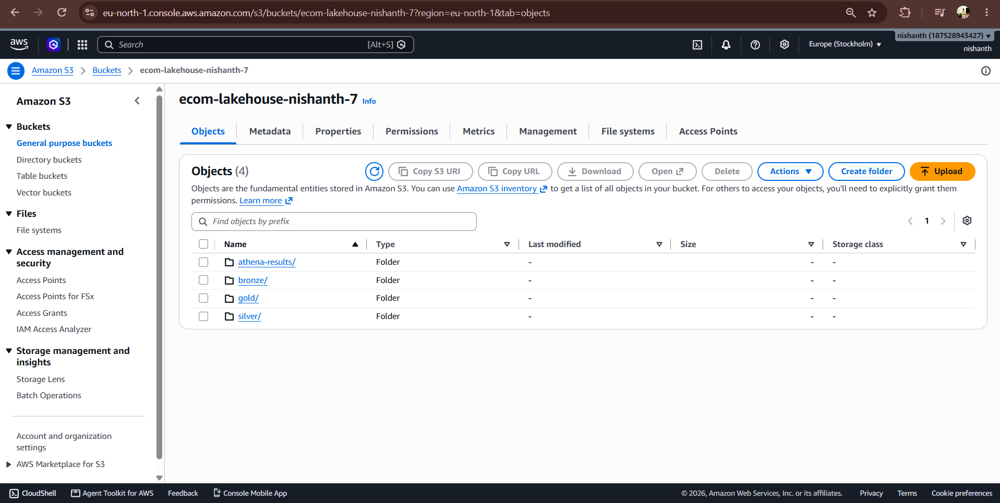

---

### Step 2: AWS IAM Least-Privilege Security Role
- **Role Name:** `AWSGlueServiceRole-Ecommerce`
- **Permissions:** Configured trust relationship with `glue.amazonaws.com`.
- **Attached Policies:**
  - `AWSGlueServiceRole` (AWS managed policy for Glue worker communication).
  - Inline policy granting least-privilege read/write access strictly to `ecom-lakehouse-nishanth-7/*`, Glue Data Catalog actions, and CloudWatch logs.

| IAM Role Overview | Managed Policy | Inline Policy Detail |
| :---: | :---: | :---: |
| 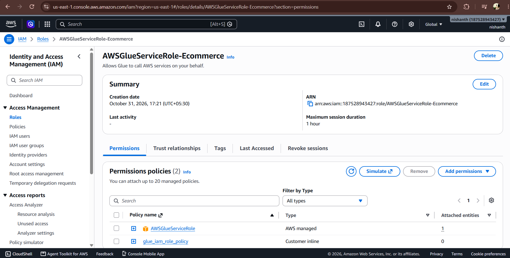 | 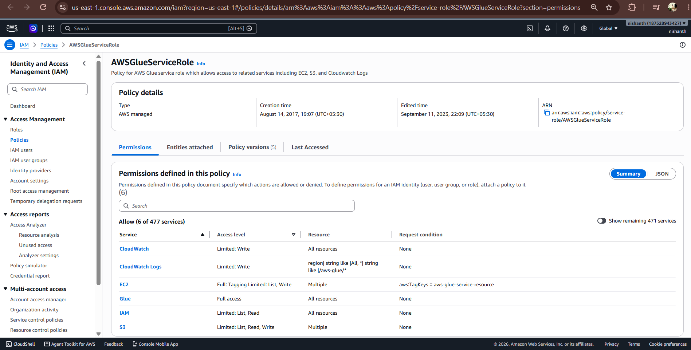 | 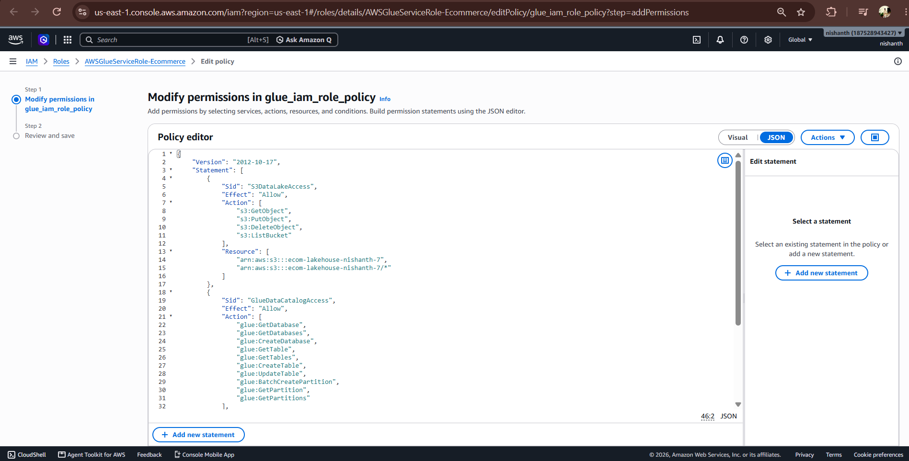 |

---

### Step 3: Serverless AWS Glue 4.0 PySpark ETL Job
- **Job Name:** `ecommerce_batch_etl`
- **Compute:** Glue 4.0 (Apache Spark 3.3, Python 3, 10 DPUs with worker type `G.1X`).
- **Processing:** Processed 550,000+ records across 8 datasets:
  - Cleaned and parsed ISO UTC timestamps.
  - Quarantined 814 duplicate review records and 2 negative/invalid payment records.
  - Converted data into Snappy-compressed columnar Parquet.
  - Built the Kimball Star Schema facts and pre-aggregated analytics marts in Gold.
- **Status:** **Succeeded** (Execution completed without error).

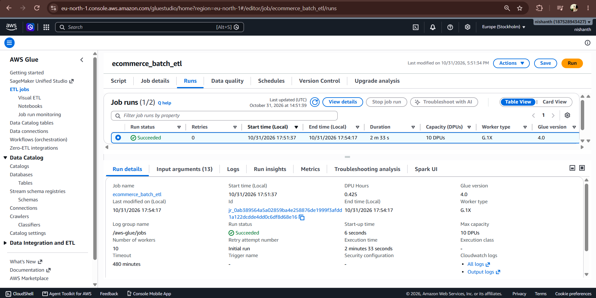

---

### Step 4: AWS Glue Crawler & Automated Metadata Discovery
- **Crawler Name:** `ecommerce_gold_crawler`
- **Target Path:** `s3://ecom-lakehouse-nishanth-7/gold/`
- **Database:** `ecommerce_lakehouse_db`
- **Outcome:** The crawler traversed all Gold directories, inferred the Parquet schemas, and automatically registered all dimensional tables and marts in the Glue Data Catalog.

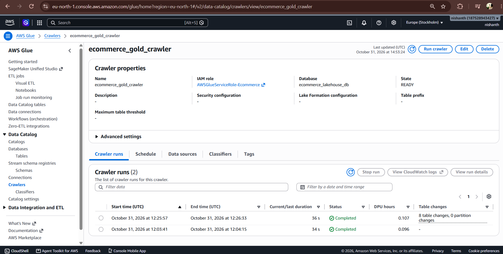

---

### Step 5: AWS Glue Data Catalog (Metastore & Schema Definitions)
- **Database:** `ecommerce_lakehouse_db`
- **Cataloged Tables (8):**
  - Dimensions: `dim_customers`, `dim_products`, `dim_sellers`
  - Facts: `fact_order_items`, `fact_payments`
  - Marts: `gold_daily_sales`, `gold_delivery_kpis`, `gold_product_performance`
- **Format:** All tables classified as **Parquet**.

| All 8 Catalog Tables Registered | Table Schema (`gold_daily_sales`) |
| :---: | :---: |
| 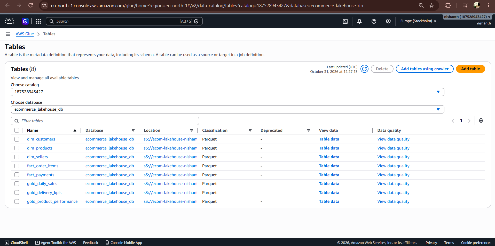 | 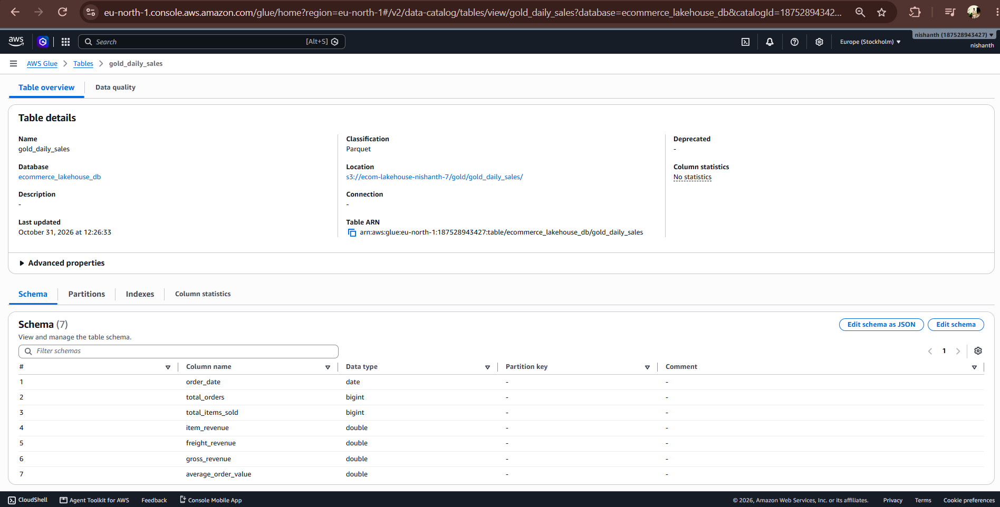 |

---

### Step 6: Interactive Amazon Athena SQL Analytics

Amazon Athena runs serverless Presto SQL queries directly on top of the S3 Parquet tables using the Glue Data Catalog metastore.

#### 6.1 Top 10 Product Categories by Revenue
Identifies the highest revenue-generating product categories, units sold, and average price.
- **SQL Query:**
  ```sql
  SELECT 
      product_category_name_english,
      units_sold,
      total_revenue,
      avg_unit_price
  FROM ecommerce_lakehouse_db.gold_product_performance
  ORDER BY total_revenue DESC
  LIMIT 10;
  ```
- **Finding:** `health_beauty` is the top-grossing category with 9,670 units sold, followed by `watches_gifts` and `bed_bath_table`.

| Query Execution | Result Set |
| :---: | :---: |
| 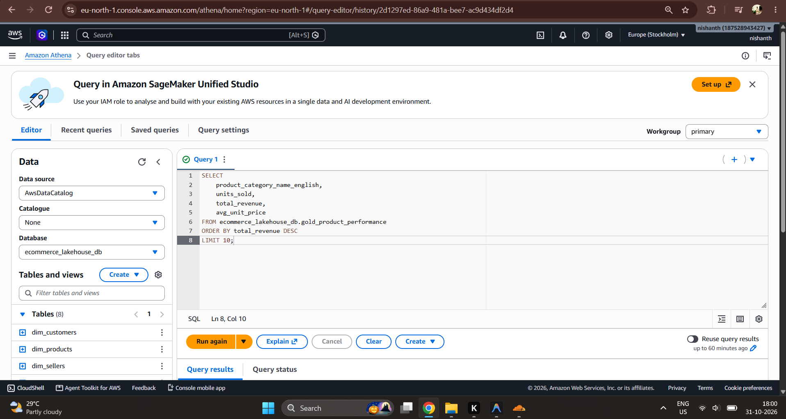 | 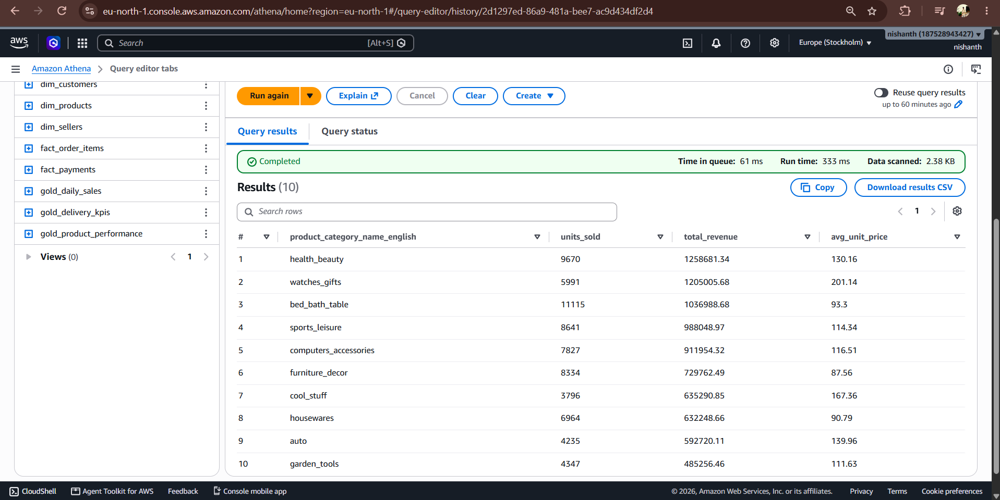 |

---

#### 6.2 Delivery SLA & Late Delivery Rates by State
Measures delivery latency in days and SLA breach percentage across Brazilian states.
- **SQL Query:**
  ```sql
  SELECT 
      customer_state,
      SUM(total_delivered_orders) AS total_orders,
      SUM(late_orders_count) AS late_orders,
      ROUND(SUM(late_orders_count) * 100.0 / SUM(total_delivered_orders), 2) AS late_rate_pct,
      ROUND(AVG(avg_delivery_duration_days), 1) AS avg_delivery_days
  FROM ecommerce_lakehouse_db.gold_delivery_kpis
  GROUP BY customer_state
  ORDER BY late_rate_pct DESC;
  ```

| Query Execution | Result (High Latency States) | Result (SLA Performance) |
| :---: | :---: | :---: |
| 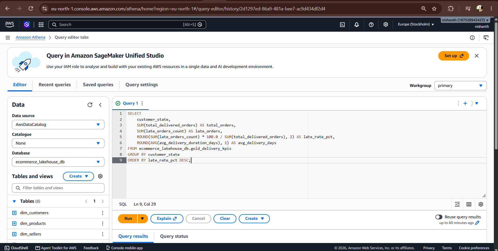 | 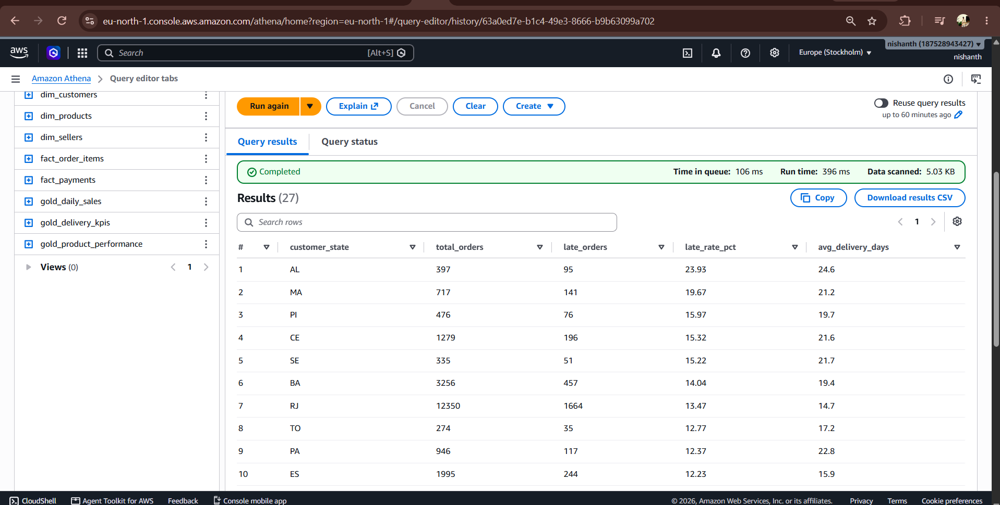 | 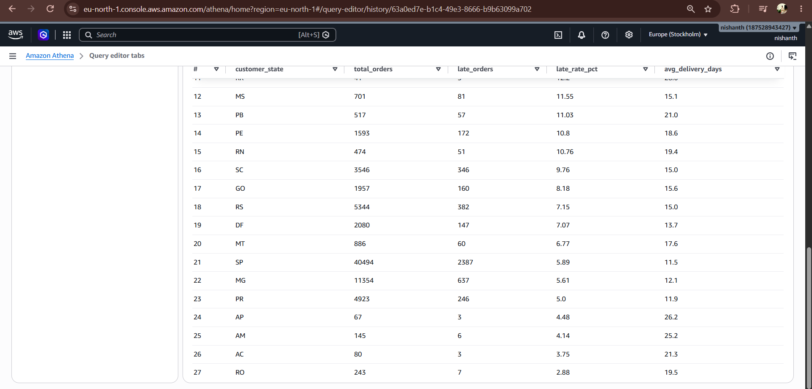 |

---

#### 6.3 Payment Method Popularity & Monetary Volume
Analyzes customer payment preferences and overall monetary distribution across transaction types.
- **SQL Query:**
  ```sql
  SELECT 
      payment_type,
      COUNT(DISTINCT order_id) AS total_orders,
      ROUND(SUM(payment_value), 2) AS total_revenue
  FROM ecommerce_lakehouse_db.fact_payments
  GROUP BY payment_type
  ORDER BY total_revenue DESC;
  ```
- **Finding:** Credit cards dominate transaction volume with over 75% of total gross revenue processed, followed by boleto and vouchers.

| Query Execution | Result Set |
| :---: | :---: |
| 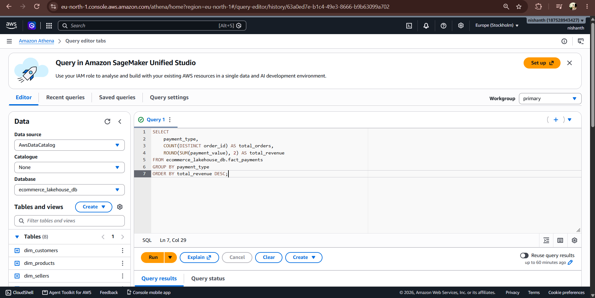 | 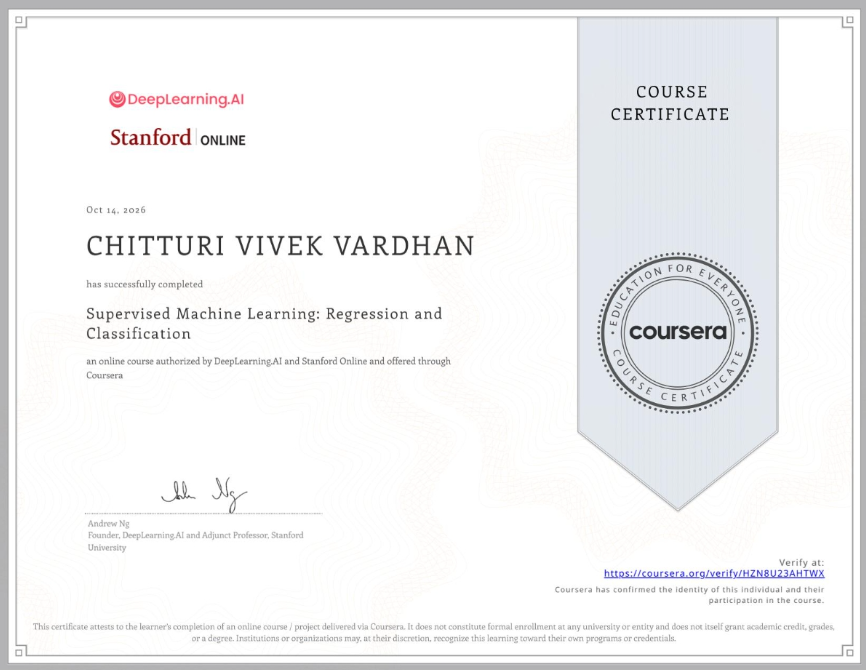 |

---

## Repository Structure

```text
├── config/                  # Configuration files (YAML, settings loader)
├── data/                    # Sample synthetic data and download instructions
│   └── sample/              # Micro-sample CSVs for instant local testing
├── docs/                    # Architecture deep-dive, data dictionary, decision logs
│   ├── architecture.md      # Record journey, S3 layout, cost optimizations
│   ├── data_dictionary.md   # Schemas, primary/foreign keys, and declared grains
│   └── decisions.md         # Architecture Decision Records (ADRs)
├── ingestion/               # Bronze ingestion, manifest generator, S3 uploader
├── transformations/         # Silver PySpark data cleaning & standardization
├── modeling/                # Gold dimensional modeling (facts, dims, marts)
├── data_quality/            # Reusable validation rules & quarantine handler
├── glue_jobs/               # Unified AWS Glue PySpark job scripts
├── infrastructure/          # IAM policies and Glue Catalog setup scripts
├── screenshots/             # Visual proof screenshots of AWS console execution
├── sql/                     # Athena SQL analytical queries for business KPIs
├── tests/                   # Pytest test suite for transformations & quality rules
├── requirements.txt         # Pinned Python package dependencies
├── .env.example             # Configuration environment variable template
└── .gitignore               # Strict gitignore for credentials and raw data
```

---

## Quickstart & Local Setup

### 1. Set Up Environment
```bash
# Clone the repository
git clone https://github.com/NISHANTH-KONCHADA/aws-ecommerce-lakehouse.git
cd aws-ecommerce-lakehouse

# Create and activate virtual environment
python -m venv venv
.\venv\Scripts\Activate.ps1   # Windows PowerShell
# source venv/bin/activate     # Mac/Linux

# Install dependencies
pip install -r requirements.txt

# Configure settings
cp .env.example .env
```

### 2. Run the Full Local Pipeline (Zero AWS Charges)
```bash
# [Step 1] Profile source datasets
python -m ingestion.profile_source --data-dir ./data/sample

# [Step 2] Ingest raw files to Bronze layer (with SHA-256 checksums & manifests)
python -m ingestion.extract --source-dir ./data/sample

# [Step 3] Transform Bronze CSVs to Silver Parquet (with Data Quality & Quarantine)
python -m transformations.runner

# [Step 4] Build Gold Kimball Star Schema & Aggregated Analytics Marts
python -m modeling.build_gold_marts

# [Step 5] Run Automated Test Suite
pytest -v tests/
```

---

## Interview Questions & Architectural Mastery

<details>
<summary><b>1. Why choose Amazon S3 as the data lake instead of a Data Warehouse?</b></summary>
Amazon S3 decouples compute and storage completely. Storage costs are extremely low (\$0.023/GB/month) with 99.999999999% (11 9s) durability. S3 allows ingesting raw, semi-structured, and columnar formats in parallel, allowing compute engines (PySpark, Glue, Athena, Presto) to spin up only on demand.
</details>

<details>
<summary><b>2. Why use Apache Parquet instead of CSV in Silver and Gold?</b></summary>
Parquet is a columnar storage format with built-in Snappy compression and dictionary encoding. Amazon Athena charges \$5.00 per TB of data scanned. By converting CSV to Parquet:
- File sizes shrink by 75-80%.
- Athena only scans columns referenced in the query (column pruning), reducing query runtimes and costs by up to 90%.
</details>

<details>
<summary><b>3. How do you avoid many-to-many fan-out between order items and payments?</b></summary>
An order can contain $N$ line items and $M$ payment installments. A naive SQL join on `order_id` causes a Cartesian product of $N \times M$ rows, artificially inflating sums of price and payment_value. We maintain separate fact tables at declared grains (`fact_order_items` at grain `order_id + order_item_id` and `fact_payments` at grain `order_id + payment_sequential`), and aggregate each table to `order_id` level before joining.
</details>

<details>
<summary><b>4. How is pipeline idempotency guaranteed?</b></summary>
Every batch ingestion writes to partitioned paths with deterministic partition keys (`ingestion_date=YYYY-MM-DD` in Bronze, `year=YYYY/month=MM/` in Silver). Transformations use dynamic partition overwrite mode (`spark.sql.sources.partitionOverwriteMode=dynamic`), guaranteeing that re-running a batch overwrites only that specific partition without generating duplicate records.
</details>

---

## License
MIT License. Developed for educational and production demonstration of AWS Batch Data Engineering.
